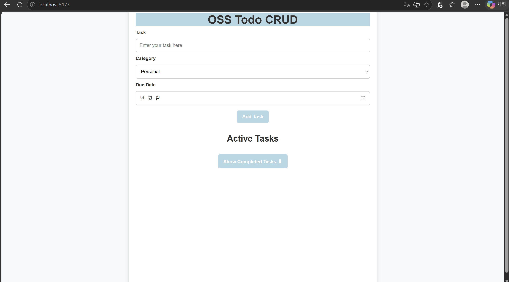

Project Structure: 주요 파일 2~3개의 역할
App.jsx = 기본 HTML과 Java Script 기능들이 구현되어있다.
App.css = App.jsx에 구현된 HTML을 꾸미는 역할을 한다.
Main.jsx = root를 만들어 다른 파일들을 실행한다.

React Component: 주요 컴포넌트 1~2개의 역할
App.jsx의 deleteTask = filter 사용해서 해당 todo 작업을 삭제한 새로운 Tasks 만듬
completeTask = 특정 task의 인덱스를 받아 완료된 칸으로 옮기고 기존 todo에서 제거함

Code Analysis: 코드 1개(약 5~15줄)를 선택하여 동작 원리 설명

const saveEdit = () => {
    const updatedTasks = [...tasks];
    updatedTasks[editIndex].text = editText;
    setTasks(updatedTasks);
    setEditIndex(null);
  };

Project Information: 프로젝트 소개, 선택 이유, 원본 GitHub URL 및 라이선스
 간단하게 Todo 항목들을 관리할 수 있는 CRUD 프로그램입니다. 코드가 가볍고, 로그인이나 api를 만들어야 하는 필요가 없어서 선정하였습니다. 
 원본 Github URL: https://github.com/Jadec15/react-todo-app

Installation: 설치·실행 방법 및 실행 화면
npm install 후 npm run dev

Deployment: 실제 접근 가능한 Vercel URL
Weekly Review:
새롭게 배운 내용 3가지
어려웠던 점과 해결 방법
AI 활용 내용 및 느낀 점

  <input value={editText} onChange={(e) => setEditText(e.target.value)} />
  <button onClick={saveEdit}>💾 Save</button>

  input을 통해 editText를 입력받아 save 버튼을 누르면 ...tasks를 통해 원래 내용을 받고 updatedTasks[index].text = 로 내용을 변경한 후에 setTasks를 통해 화면에 표시한다. 

수정 파일명과 변경 전/후
App.jsx 변경 전 제목 To-Do List  변경 후 OSS Todo CRUD
App.css 변경 전 버튼 색 background-color: #2b946c 변경 후 background-color: lightblue;
App.jsx 변경 전 Task input위에 라벨이 없었음 변경 후 72번 줄에 
Task
 추가.

# React To-Do List App

A simple and interactive To-Do List built with React! 
Users can add, edit, delete, and mark tasks as completed. Users can mark the type of task and the Due date. Tasks are stored locally and persist after refresh.

---

# Features
- Add tasks with type and due dates
- Mark tasks as completed
- Undo completed tasks
- Edit existing tasks
- Delete tasks
- Data is saved using `localStorage` (persists after refresh)

---

# Installation & Setup

# 1️ Clone the Repository
git clone https://github.com/jadec15/react-todo-app.git
cd react-todo-app

# 2️ Install Dependencies
Install Node.js if you don't already have it installed. Then run the command:
npm install

# 3️ Start the Development Server
npm run dev
The app will open in your browser at http://localhost:5173/.

# Built With
React (Vite)
JavaScript (ES6+)
CSS (Custom Styling)
LocalStorage API (for saving tasks)

# How to Use
Enter a task in the input box and click "Add Task".
Set a category and due date if needed.
Click ✅ to mark a task as completed.
Click ❌ to delete a task.
Click ✏️ to edit a task.
Click "Show Completed Tasks ⬇️" to view completed tasks.
Refresh the page and tasks remain saved

# Customization
Want to modify the project for yourself? Here’s where you can make changes:

App.jsx → Main logic and UI.
App.css → Styling.
localStorage handling → Modify task persistence.

# Contributing
This is a personal project, and contributions are not accepted at this time.

# License
This project is open-source under the MIT License.

# Contact
Have questions? Reach out via: mail: jadecabral96@gmail.com

⭐ If you like this project, give it a star on GitHub! ⭐